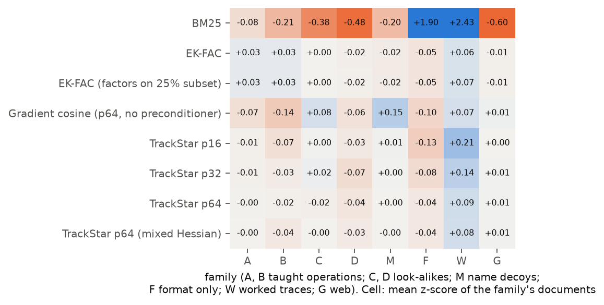
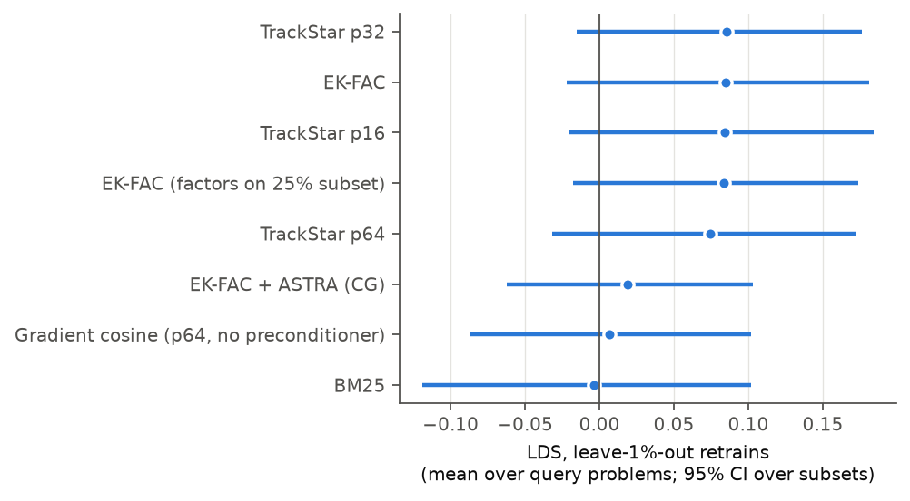
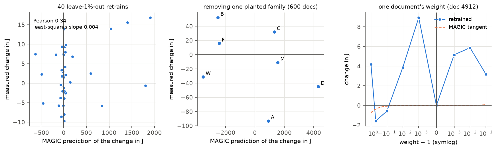
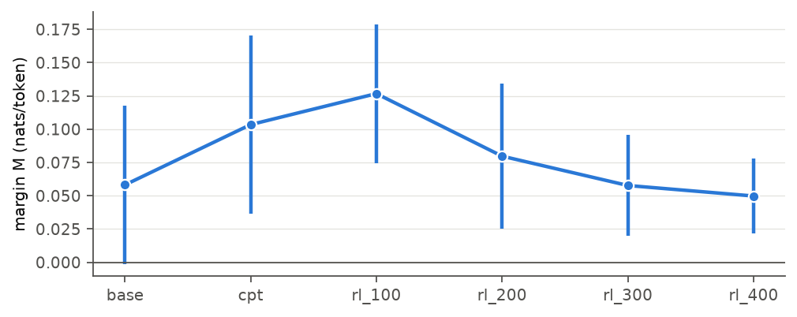

# Synthetic gate v3: does attribution recover ground truth under CPT → GRPO?

*Run on Lambda (A100 40 GB, H100 PCIe) on 2026-11-01; §3b (EK-FAC + ASTRA, exact metagradients, weight scan) added the same day. Code: [scripts/gate_v3.py](../../scripts/gate_v3.py). Design and Bergson details: [docs/06_attribution_methods.md](../../docs/06_attribution_methods.md) §3.*

**Question.** Before using Bergson on Olmo 3, does any method, configured as its maintainers recommend, recover *measured* ground truth in a small flow with the same structure: continued pretraining (CPT) with planted data, then GRPO, then attribution of RL solutions back to the CPT data with GRPO queries?

## Summary

1. **RL creates the capability, and it depends on specific pretraining data.** After CPT the model solves long A-then-B compositions 0% of the time; after GRPO, 65%. Removing family A, family B or the worked composition traces W from CPT reduces the RL gain to 0%. Name decoys and format-only documents do not matter.
2. **At the family level, the two recommended methods get different ground truths right, and neither gets both.**
   - *What the RL gain needs.* Ranked by attribution mass, EK-FAC puts W, B, A first, the three families the RL gain cannot do without (Spearman ρ = 0.89 against the RL accuracy lost when each family is removed; exact permutation p = 0.007). Subset-fit EK-FAC gives the same ranking. TrackStar at projection 16/32/64 is near chance (ρ = −0.11 to 0.19) and ranks the name decoys above both taught operations.
   - *What the attributed objective does.* Against the change in the objective itself when each family is removed (smooth regime), **EK-FAC refined by ASTRA's conjugate-gradient solver does best** (ρ = 0.75, p = 0.033, 6 of 7 signs right, top three families exactly right), then TrackStar p32 (ρ = 0.68, p = 0.055, all 7 signs). Plain EK-FAC is weaker (ρ = 0.25): it credits B as support, but removing B *raises* the correct-minus-incorrect margin by 52, even though B is necessary for the RL gain. ASTRA's refinement fixes that (§3b).
   - Plain gradient cosine is inverted on both (ρ = −0.93, −0.64).
3. **Document-level ground truth needs a smooth training regime, and neither regime was smooth enough.** At the first CPT learning rate (2e-4), removing one random document out of 7,200 changed the attributed objective by 30–100%. Every retraining-based LDS in that regime is noise (all methods ≈ 0). At learning rate 5e-5, with deterministic attention kernels, one document moves the objective by 0.4–2.6%. But halving a document's weight moved it the opposite way from removing it (+4.2 removed, −1.6 at half weight), so single-document effects are still not locally linear. On 40 leave-1%-out retrains (Bergson's leaderboard protocol), every preconditioned gradient method scores LDS ≈ 0.08 (EK-FAC 0.085, TrackStar p32 0.085, 95% intervals reaching −0.02), against ≈ 0 for gradient cosine and BM25. At the document level this setting cannot separate the recommended methods.
4. **Exact metagradients show why: retraining here is deterministic but chaotic, so no first-order method can predict it at the document level (§3b).** MAGIC-style metagradients through the exact training run (replayed bit for bit, checked against finite differences) predict leave-1%-out retraining no better than the approximate methods: the predicted direction matches the measured change for 21 of 40 retrains and for 2 of 7 families, with magnitudes a median 14× too large. Changing one document's weight by 0.1% moves the objective by 5–9 units (3–5%), more than deleting that document, and as much as the spread of leave-1%-out outcomes (SD 6.7). The sensitivity builds up in the first ~130 of 675 steps (warmup and peak learning rate): the reverse pass's adjoint grows about 30× there.
5. **The two cost-saving recommendations hold.**
   - EK-FAC factors fit on 25% of the documents reproduce full-fit EK-FAC: 97.5% / 90.5% of the same top 1% in the two regimes, and the same family ranking.
   - Two-stage retrieval (TrackStar p32 over everything, EK-FAC on each query's top 10%) keeps 75% / 90.5% of full EK-FAC's top 1%, against 34–43% for TrackStar alone.
6. **For RL items, restoring |A| after unit normalization matters.** It changes the share of score mass by item type by up to 45% relative to Bergson's sign-only result.
7. **Gate decision (plan v3 §4).** G1 (recovery) passes for EK-FAC at the family level, and EK-FAC + CG is the best method on the family-level effects on the objective. G5 (LDS ≥ 0.4) fails for every method, exact metagradients included, because document-level retraining is chaotic here. Under the plan's rules, the 7B study reports source-level rankings, not effect sizes, and uses agreement between the TrackStar and EK-FAC stages as the evidence (§7). The first such 7B run is in [../olmo7b_midtrain/](../olmo7b_midtrain/README.md).

## 1. Setup

SmolLM2-135M. CPT on 7,200 documents (3,000 FineWeb-Edu + 600 per planted family; 1.09M tokens, 3 epochs, AdamW, batch 32, cosine schedule), then GRPO with TRL (Dr. GRPO advantages, no KL, clip 0.2/0.272, 8 rollouts per prompt, constant learning rate 1e-5, 400 steps) on A-then-B (1,000), A (1,000), B (1,000) and C-then-D (500) prompts.

| Family | Content |
|---|---|
| A, B | definitions and examples of `zorp` (digit substitution) and `blick` (positional rewrite) |
| C, D | look-alike operations `zarp` (substitution), `blink` (positional) |
| M | sentences that mention `zorp` and `blick` and teach nothing (lexical decoys) |
| F | the RL prompt/answer format around trivial arithmetic |
| W | solved C-then-D compositions in the RL solution format (the analogue of reasoning-trace midtraining) |
| G | FineWeb-Edu |

Accuracy (pass@1, 8 samples per problem at T = 1):

| | base | after CPT | after GRPO |
|---|---:|---:|---:|
| A then B, 3–4 digits (trained length) | 0.000 | 0.023 | **0.996** |
| A then B, 5–6 digits (never trained) | 0.000 | **0.000** | **0.646** |
| C then D, 3–4 digits | 0.000 | 0.994 | 0.982 |
| single A / single B | 0 / 0 | 0.06 / 0.33 | 1.00 / 1.00 |

**Queries.** The GRPO model's rollouts on 16 held-out 5–6-digit A-then-B problems (CPT 0/8 on every problem; the analogue of RL-gained problems), 8 per problem, Dr. GRPO advantages. All 16 have mixed rewards (1–7 of 8 correct). Gradients are taken at the CPT checkpoint, the end of the stage being attributed. The attributed objective is J_p = Σᵢ Aᵢ log p(yᵢ), which is k(n−k)/n times the correct-minus-incorrect margin.

**Methods** (bergson 2.7.0, configurations from the leaderboard YAMLs): TrackStar at projection 16, 32, 64 (and 64 with query/train Hessian mixing), autocorrelation preconditioning and unit normalization, |A| restored per rollout; projected gradient cosine without preconditioning (p64); EK-FAC (KFAC + eigenvalue correction, damping 0.1), with factors on all documents or on a 25% subset; EK-FAC + ASTRA's conjugate-gradient solver; two-stage TrackStar p32 → EK-FAC on each query's top 10%; BM25 on the problem text plus its correct rollouts.

## 2. Ground truth 1: what the RL gain depends on (capability ablations)

Each row removes one family from CPT and reruns GRPO (200 steps). Accuracy of the RL model on 5–6-digit A-then-B problems:

| removed from CPT | none | A | B | W | D | C | F | M |
|---|---|---|---|---|---|---|---|---|
| RL accuracy | 0.62 | **0.00** | **0.00** | **0.00** | 0.40 | 0.53 | 0.60 | 0.63 |

Without W, RL still learns A and B individually (both ≈ 1.0) but cannot compose them, even at the trained length (0.14). Removing prompt types from GRPO instead (CPT unchanged): without A-then-B prompts, 0.00 (single-operation practice does not transfer to composition); without single-A prompts, 0.00 (RL cannot bootstrap A from the compositions alone). These effects (0 vs 0.6) are far above retraining noise, so they are the most reliable ground truth in this study.

**Attribution against it** (attribution mass per family, summed over the 16 queries, CPT checkpoint, learning rate 2e-4; Spearman over the seven planted families; exact one-sided permutation p over all 5,040 orderings):

| Method | ρ | p | ranking (most credited first) |
|---|---:|---:|---|
| **EK-FAC** | **0.89** | **0.007** | W B A C D M F |
| **EK-FAC, factors on 25% subset** | **0.89** | **0.007** | W A B C D M F |
| TrackStar p16 | 0.19 | 0.36 | W C M A B D F |
| TrackStar p32 | 0.11 | 0.42 | W C M B A F D |
| TrackStar p64 | −0.11 | 0.61 | W M C B F A D |
| TrackStar p64, mixed Hessian | 0.15 | 0.39 | W M A C D B F |
| BM25 | 0.15 | 0.39 | W F A M B C D |
| Gradient cosine, p64 | −0.93 | 1.00 | M C F D A W B |

Seven families is a coarse test, but it is the level at which the 7B study would report results (sources and bins, not single documents).



## 3. Ground truth 2: retraining LDS, and why it needs a smooth regime

Retrains change only per-document loss weights (same order, batches and schedule) and are deterministic: two identical runs give identical J. The question is whether J is a *smooth* function of the weights.

**Learning rate 2e-4 (first run): chaotic.**

| perturbation | J_total |
|---|---:|
| full data, gradient micro-batch 16 | 141.6 |
| full data, micro-batch 32 (same math, different bf16 summation order) | 116.4 |
| remove 1 random document (two draws), micro-batch 16 | 98.3, 130.7 |
| remove 1 random document (two draws), micro-batch 32 | 230.1, 129.1 |

One document out of 7,200 moves J by 30–100%, so no retraining design can rank methods here. Over 16 queries, LDS was 0.03 to −0.08 for every method on 24 random-half retrains, and −0.11 to −0.01 on 38 dose-design retrains, all intervals spanning 0. The same instability makes family-removal effects on J (as opposed to RL accuracy) unreliable: removing the M decoys appeared to lower J by 30.

**Learning rate 5e-5, math attention kernels: smooth.** Same corpus and query rollouts; CPT at learning rate 5e-5 (single-op B is no longer learned, A stays at 8%); flash and memory-efficient attention disabled. Two identical runs, on two different A100 instances, give the same J (162.392).

| perturbation | J_total | change |
|---|---:|---:|
| full data | 162.39 | |
| remove document d₀ | 161.70 | −0.70 |
| remove document d₁ | 166.57 | +4.18 |
| document d₁ at half weight | 160.82 | **−1.57** (linear would be about +2.1) |
| 40 random leave-1%-out retrains (72 documents each) | 154–178 (SD 6.9) | |

The response is far smaller than at 2e-4 (0.4–2.6% per document instead of 30–100%) but not locally linear: half a removal moves J in the opposite direction from a whole one. Per-document effects of a few units are partly chaotic, and the leave-1%-out outcomes are their sum.

LDS on the 40 leave-1%-out retrains (16 queries, 95% bootstrap interval over retrains):

| Method | LDS (leave-1%) | Plain objective* |
|---|---|---|
| TrackStar p32 | 0.085 [−0.015, 0.176] | 0.082 [−0.127, 0.273] |
| EK-FAC | 0.085 [−0.022, 0.181] | 0.099 [−0.118, 0.287] |
| TrackStar p16 | 0.084 [−0.021, 0.184] | |
| EK-FAC, factors on 25% subset | 0.083 [−0.018, 0.174] | |
| TrackStar p64 | 0.075 [−0.032, 0.172] | |
| Gradient cosine, p64, no preconditioner | 0.007 [−0.087, 0.102] | |
| BM25 | −0.004 [−0.119, 0.102] | |

\*Log-likelihood of the correct rollouts only, attributed with plain queries (advantage +1) against the same retrains. It is no easier to predict than the GRPO margin, so the contrast in the GRPO query is not what limits accuracy here.

Preconditioning matters (≈ 0.08 with it, ≈ 0 without), and the recommended methods are indistinguishable at this level. These LDS values sit well below the leaderboard's (TrackStar p32 0.19, EK-FAC 0.45 for GPT-2 on WikiText, whose fine-tune has metasmoothness 0.989), which is what a non-linear response predicts.

**Family removal in the smooth regime.** Removing 600 documents moves J far beyond the per-document noise, so family-level effects on the attributed objective are measurable here (CPT only, no GRPO):

| family removed | A | D | W | M | F | C | B |
|---|---:|---:|---:|---:|---:|---:|---:|
| J(full) − J(without family) | **+93.1** | +45.0 | +31.2 | +11.3 | −15.9 | −31.9 | **−52.1** |

B opposes the margin in both regimes (−52 here, −44 at 2e-4): with partial knowledge of `blick`, the wrong answers become likelier too. Attribution mass per family against these effects (Spearman over 7 families, exact permutation p, share of signs right):

| Method | ρ | p | signs right | ranking |
|---|---:|---:|---:|---|
| **TrackStar p32** | **0.68** | 0.055 | **7/7** | W A M D B C F |
| TrackStar p64 | 0.50 | 0.13 | 6/7 | W A M B D C F |
| EK-FAC | 0.25 | 0.30 | 4/7 | W B A D M C F |
| EK-FAC, factors on 25% subset | 0.18 | 0.36 | 4/7 | W B A M D C F |
| BM25 | 0.18 | 0.36 | 4/7 | W F A M B C D |
| TrackStar p16 | −0.11 | 0.61 | 3/7 | W M C B A D F |
| Gradient cosine, p64 | −0.64 | 0.95 | 1/7 | C F B W A D M |
| truth | | | | A D W M F C B |

Read together with §2: EK-FAC's family ranking (W, B, A first) is the same in both regimes and matches what the RL capability needs, but not how each family moves the margin the queries define. TrackStar p32 follows the margin but not the capability. With 7 families each, neither difference is conclusive on its own.



Retraining determinism needed two fixes, both of which the gate caught: the flash and memory-efficient attention backward passes are not deterministic (PyTorch only warns under `warn_only`), and changed J by 5% between identical runs on the A100. The math backend is. And the prompt must end in a token that appears the same way inside training documents (a SmolLM2 prompt ending in a blank line does not).

## 3b. EK-FAC + ASTRA, exact metagradients, and why document-level LDS stays low

Everything here is in the smooth regime (CPT learning rate 5e-5), against the same 40 leave-1%-out retrains and family removals as §3. Tables: [../gate_v3_smooth/methods_total.csv](../gate_v3_smooth/methods_total.csv), [methods.csv](../gate_v3_smooth/methods.csv), [magic_linearity.csv](../gate_v3_smooth/magic_linearity.csv), [astra_total_objective.csv](../gate_v3_smooth/astra_total_objective.csv).

**EK-FAC + ASTRA.** Both of ASTRA's solvers start from the EK-FAC solution, with the leaderboard's settings ([docs/06](../../docs/06_attribution_methods.md)).

- *Momentum SGD* (300 steps, 16 documents per step), run on the summed query of all problems. The step size was chosen by the leaderboard's rule: the lowest final / |step-0| objective, never LDS. Step sizes of 3e-6 and above diverged (1e-4 and 3e-5 to NaN), as on the leaderboard (1e-5 and above). The selected 1e-6 (objective 6.8e11 → 3.8e10) and 3e-7 reached LDS 0.02 and 0.04 on the summed objective J_total, below plain EK-FAC (0.16).
- *Conjugate gradients* (20 steps on 256 documents, damping 10), per problem. Every objective started positive (the EK-FAC solution overshoots) and fell by more than 99.8%; 11 of 16 ended negative, e.g. 1.5e8 → −6.7e5. It took 72 minutes on an A100 for 16 queries, including the factor fit. The result is the best family-level attribution in the gate:

| Method | ρ against family-removal effects on J | permutation p | signs right | ranking |
|---|---:|---:|---:|---|
| **EK-FAC + ASTRA (CG)** | **0.75** | **0.033** | **6/7** | **A D W** B M C F |
| TrackStar p32 | 0.68 | 0.055 | 7/7 | W A M D B C F |
| EK-FAC | 0.25 | 0.30 | 4/7 | W B A D M C F |
| exact metagradient (MAGIC) | −0.29 | 0.75 | 2/7 | W B F A C M D |
| *measured* | | | | *A D W M F C B* |

The refinement mostly reorders the families plain EK-FAC gets wrong. EK-FAC credits B as the second strongest support for J and scores D and M as opposing it; with CG, A, D and W lead, as in the retraining. B, whose removal actually *raises* J, is CG's one wrong sign, but it drops from second to fourth.

At the document level the solvers do not separate from anything else. Per-query leave-1%-out LDS is 0.02 [−0.06, 0.10] for CG against 0.085 for EK-FAC. On J_total, the sum of the 16 CG columns gives 0.16, the same as EK-FAC; a single CG solve on the summed query (which did not converge in 20 steps) gives 0.33 [0.00, 0.63]. Two CG variants of one target differing by 0.17 is the same story as below: at this level, 40 retrains cannot rank methods.

**Exact metagradients (MAGIC).** `synthetic/magic.py` differentiates J through all 675 AdamW steps of `train_cpt`: a forward pass with checkpoints every 26 steps, then a reverse pass that recomputes each segment and applies the adjoint of each AdamW update, with one double backward per micro-batch for the Hessian-vector product and dJ/dw_d. It is exact by construction, and it is checked two ways:

- On tiny models the replay is bit-identical to `train_cpt`, and the metagradients match float64 finite differences to 1e-9.
- At scale, the replayed run reproduces the original run's J_total exactly (162.391751).

One reverse pass computed six targets (J_total, J_p for four problems, the plain objective) in 101 minutes on an A100. Bergson's own MAGIC trains with its own trainer and ignores advantages, so it could not attribute this run's GRPO objective.

| | exact metagradient | best approximate method |
|---|---:|---:|
| LDS on J_total, 40 leave-1%-out retrains | 0.22 [−0.12, 0.52] | 0.16–0.33 (EK-FAC and the CG variants) |
| per-query LDS, 4 problems | 0.04 | 0.17 (TrackStar p32), 0.11 (EK-FAC) |
| plain objective summed over problems | 0.22 [−0.10, 0.51] | 0.21 (TrackStar p32), 0.18 (EK-FAC) |
| predicted direction of the change in J, 40 retrains | 21/40 | |
| family-removal signs | 2/7 | 6/7 (EK-FAC + CG) |
| size of predicted vs measured change (median ratio) | 14× too large | |

Because MAGIC predicts the change in J itself, its error can be read off directly. Taken with the fact that it is the exact derivative of the attributed run, this says the ground truth is not first-order predictable here, whatever the method.

**Why: the run is chaotic at the scale of single documents.** Retraining with one document's weight set to values near 1:

| weight of document 4912 | 0 (removed) | 0.5 | 0.9 | 0.99 | 0.999 | **1** | 1.001 | 1.01 | 1.1 |
|---|---:|---:|---:|---:|---:|---:|---:|---:|---:|
| change in J_total | +4.18 | −1.57 | −0.58 | +3.87 | **+8.94** | 0 | **+5.15** | +5.87 | +3.17 |
| exact metagradient × (weight − 1) | −0.74 | −0.37 | −0.07 | −0.007 | −0.001 | 0 | +0.001 | +0.007 | +0.07 |

A 0.1% change to one of 7,200 documents moves J by 5–9 (3–5%), more than removing the document, and in the same direction whichever way the weight moves. The run is deterministic (identical weights give identical J), so this is not noise but sensitivity to initial conditions. The metagradient's reverse pass shows where it comes from: the adjoint's norm is ~4–6 × 10³ over most of the run, then grows to 2.8 × 10⁴ by step 130 and 1.3 × 10⁵ by step 26, so perturbations in the warmup and peak-learning-rate steps are amplified about 30× by the end. Any retraining, including a leave-1%-out one, picks up a jump of this size on top of the data's systematic effect. With leave-1%-out outcomes spread by SD 6.7, the systematic part is at most a fraction of what LDS correlates against. Family removals (effects of 11–93) stand well above the floor, which is why family-level ground truth works and document-level ground truth does not.



**Consequences.**

- G5 (document-level LDS ≥ 0.4) is not reachable in this setup by any first-order method, exact or approximate. Before a document-level LDS is used as a gate, the retraining map should pass a weight-scan check like the one above: small perturbations must give small, proportional changes. Bergson's MAGIC module ships a metasmoothness diagnostic for its own trainer; the leaderboard's GPT-2 fine-tune scores 0.989 on it.
- The ASTRA recommendation holds where the ground truth is measurable: CG refinement turns EK-FAC from the weakest preconditioned method on family-level effects into the best. Momentum SGD, with its step size tuned as recommended, did not help here.

## 4. Two-stage retrieval and subset-fit factors

Share of full EK-FAC's top 1% (72 documents per query, mean over the 16 queries) that each cheaper method also puts in its top 1%:

| Method | learning rate 2e-4 | learning rate 5e-5 |
|---|---:|---:|
| EK-FAC, factors fit on a 25% subset | **0.975** | **0.905** |
| Two-stage: TrackStar p32 → EK-FAC on each query's top 10% | **0.754** | **0.905** |
| TrackStar p64 / p32 / p16 | 0.394 / 0.343 / 0.285 | 0.369 / 0.434 / 0.407 |
| Gradient cosine p64 | 0.061 | 0.121 |
| BM25 | 0.000 | 0.003 |

TrackStar alone agrees with EK-FAC on fewer than half of the top documents, so it should only shortlist. Overfetching 10× and reranking with EK-FAC recovers most of the rest, as the two-stage example in Bergson intends. The EK-FAC rerank scored 720 of 7,200 documents per query.

## 5. RL items

GRPO rollouts from steps 50–150 (the window in which A-then-B is learned; 536 items with non-zero advantage) and placebo rollouts on held-out prompts (104), scored at RL checkpoint 100 with TrackStar p32 and with EK-FAC (advantage native). Share of total absolute score mass, summed over the 16 queries:

| Scoring | A-then-B items | B items | A items | C-then-D items | placebo |
|---|---:|---:|---:|---:|---:|
| TrackStar, \|A\| restored | **0.299** | 0.095 | 0.043 | −0.018 | 0.050 |
| TrackStar, sign only (Bergson's stored scores) | 0.293 | 0.128 | 0.077 | −0.025 | 0.078 |
| TrackStar, no advantage | 0.287 | 0.128 | 0.082 | −0.019 | 0.073 |
| EK-FAC, native advantage | −0.023 | −0.065 | 0.025 | −0.016 | 0.018 |

Ground truth: GRPO without A-then-B prompts, or without single-A prompts, does not acquire the capability (long A-then-B accuracy 0.00 vs 0.62). Without single-B prompts it does slightly better (0.73), so B items are not needed. TrackStar ranks the types A-then-B > B > A, putting the unneeded B items above the necessary A items. EK-FAC ranks them A > A-then-B > B (Spearman 0.87 over the three types), though it gives A-then-B items slightly negative mass, with factors fit on only 640 RL items. Trained A-then-B items score 6.7× higher per item than placebo A-then-B rollouts from the same checkpoint under TrackStar, but placebo groups are also more often all-correct (success 0.80 vs 0.65), so this is not a clean training signal. With three item types, treat this section as exploratory.

## 6. Ledger (G0)

Margin M (per-token log-likelihood of correct minus incorrect query rollouts) along the flow: base 0.058, after CPT 0.103, GRPO step 100 0.127, then 0.080 / 0.058 / 0.050 at steps 200 / 300 / 400. CPT nearly doubles the preference for correct solutions. RL raises it briefly, then lowers it as the model becomes confident in its own outputs, including wrong ones. The query rollouts come from the final RL model, so the RL checkpoints are not an independent measurement, as in the Olmo 3 pilot.



## 7. Gate decision and what it means for the 7B study

**Against plan v3's gates** ([docs/05_plan_v3.md](../../docs/05_plan_v3.md) §4):

- *G1 (recovery).* Passes for EK-FAC at the family level (the necessary families ranked first; p = 0.007). Fails for TrackStar, BM25 and gradient cosine.
- *G3 (format).* Passes for EK-FAC and TrackStar p16/p32: they rank the format-only family F last or second to last in both regimes. Gradient cosine ranks it second or third, and BM25 second.
- *G5 (LDS ≥ 0.4, lower bound > 0).* Fails for every method, including exact metagradients (§3b). Per-query best is 0.085 [−0.02, 0.18]. A weight scan shows retraining is chaotic at the single-document scale, so this gate cannot be met in this setup.

The plan's rule for G5 failing alone applies: **7B attribution is reported as rankings, not as calibrated effect sizes.**

- **Use the two-stage pipeline, and read the two stages as two views.** TrackStar p32 over everything, EK-FAC (factors on a ~30K subset) on the top candidates, exactly as recommended. Here EK-FAC tracked what the RL capability needs, and TrackStar and EK-FAC + CG tracked how families move the query margin. Where the budget allows, refine the EK-FAC stage with ASTRA's CG solver (about 4.5 minutes per query at 135M). A source that both rank highly is the claim to make; a source only one ranks highly is flagged. EK-FAC is the expensive stage at 7B ([../olmo7b_bench/](../olmo7b_bench/README.md)).
- **Report source- and bin-level results, never single documents.** Document-level LDS was noise at learning rate 2e-4 and capped at about 0.08 for every recommended method at 5e-5, because single-document effects were not locally linear in either.
- **GRPO queries work as the contrastive query** and are directly supported by Bergson. For TrackStar, restore |A| after unit normalization; for RL items it changes the type shares by up to 45%.
- **Before trusting any retraining ground truth, check smoothness:** retrain with one document's weight at 0.999 / 1.001 / 0.5 / 0 and compare the changes with the effects being measured, and force deterministic attention kernels.

## Caveats

- One model size (135M), one seed, 16 query problems. Family-level tests have 7 points.
- The capability ground truth comes from the learning-rate-2e-4 flow, whose CPT model is the one attributed in §2. The smooth regime has no GRPO run of its own.
- EK-FAC + ASTRA's momentum-SGD solver was swept on the summed query only (one solve per step size); CG was run per problem. ASTRA was run in the smooth regime only, so it has no capability ground truth.
- MAGIC's per-query comparison covers 4 of the 16 problems, and the weight scan covers one document.
- Lambda spend for the whole build was $53.81 (first pass about $30, §3b and the 7B midtraining run the rest).
- The family-level comparison in §3 uses the smooth-regime CPT model, and §2 the learning-rate-2e-4 model. EK-FAC's family ranking is the same in both; TrackStar's is not.
- EK-FAC for RL items used factors from only 640 items.

## Reproduce

```bash
export GATE_ART=artifacts/gate_v3            # learning rate 2e-4 flow
python scripts/gate_v3.py prepare && python scripts/gate_v3.py cpt && python scripts/gate_v3.py grpo
python scripts/gate_v3.py queries && python scripts/gate_v3.py attribute
python scripts/gate_v3.py groundtruth random; python scripts/gate_v3.py groundtruth dose
GATE_LFO_STEPS=200 python scripts/gate_v3.py groundtruth lfo
python scripts/gate_v3.py rl_items && python scripts/gate_v3.py rl_attribute && python scripts/gate_v3.py ledger
python scripts/gate_v3.py evaluate

export GATE_ART=artifacts/gate_v3_smooth CPT_LR=5e-5 CPT_MICRO_DOCS=16   # smooth regime (same corpus and queries)
python scripts/gate_v3.py cpt && python scripts/gate_v3.py attribute && python scripts/gate_v3.py groundtruth leave1
python scripts/gate_v3.py evaluate
GATE_ASTRA_STEPS=300 python scripts/gate_v3.py attribute ekfac_cg,ekfac_astra_total_lr1e-06,ekfac_astra_total_lr3e-07   # §3b
GATE_MAGIC_PROBLEMS=4 python scripts/gate_v3.py magic && python scripts/gate_v3.py groundtruth eps
python scripts/gate_v3.py evaluate_total
```

The Bergson YAML of every method run is written next to its outputs (`$GATE_ART/bergson/*.yaml`); the TrackStar p64 ones are copied in [configs/](configs/).
