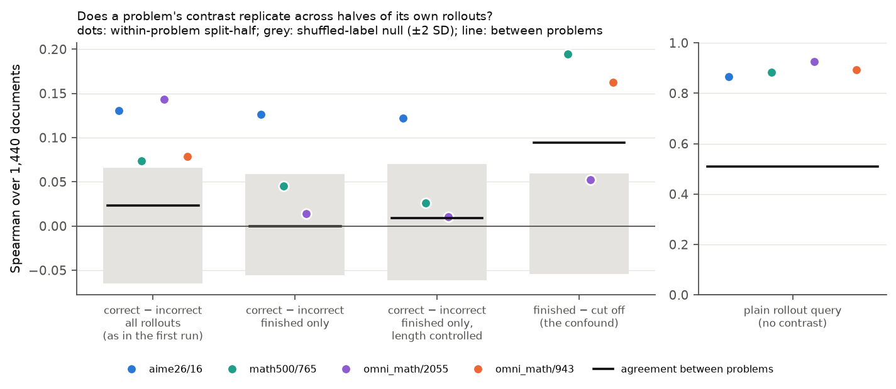

# Few problems, many rollouts: the 7B GRPO contrast within a problem

*Run on Lambda on 2026-11-04 (one 2× H100 SXM5 instance, 23 minutes, after a false start on an A100). Code: [scripts/olmo7b_deep.py](../../scripts/olmo7b_deep.py), [scripts/lambda/olmo7b_deep.sh](../../scripts/lambda/olmo7b_deep.sh). Follow-up to [../olmo7b_midtrain/](../olmo7b_midtrain/README.md).*

**Why.** In the first 7B run, the correct-minus-incorrect contrast did not give the same source ranking for two random halves of the 19 problems (split-half 0.05 for TrackStar). The Bergson maintainers suggested three things:

1. Different data may well support different problems, so a ranking that differs between problems is not by itself a failure.
2. Long documents should be split into chunks and the chunk scores averaged, instead of truncated.
3. In the RL regime it is better to collect more data on a small set of things than to go broad.

This run tests (1) directly: does a problem's contrast replicate across two halves of *its own* rollouts? It applies (2) and (3), and it also tackles the confound the first run left open: 89% of incorrect rollouts there had hit the token cap.

## Setup

- **Problems.** The 4 problems from the first run that had at least one *finished* correct and one *finished* incorrect rollout: AIME 2026 #16, MATH-500 counting & probability 765, Omni-MATH 2055 and 943.
- **Rollouts.** 64 new RL-Zero samples per problem (256 in all; T = 1, 7,680-token cap as before). vLLM 0.11.0 ran one engine per GPU with an fp8 KV cache; the first run used bf16. It took 7.3 minutes. Counts per problem are in [queries.csv](queries.csv):

  | problem | correct | finished correct | finished incorrect | cut off, incorrect |
  |---|---:|---:|---:|---:|
  | AIME 2026 #16 | 54 | 53 | 10 | 0 |
  | MATH-500 765 | 15 | 15 | 30 | 19 |
  | Omni-MATH 2055 | 34 | 16 | 4 | 26 |
  | Omni-MATH 943 | 48 | 24 | 3 | 13 |

- **Documents.** 60 documents from each of the same 24 Dolmino sources (1,440 in all). Each is kept whole up to 8,192 tokens and split into 1,024-token chunks: 3,556 chunks, 2.91M tokens. A document's score is the mean of its chunk scores. For comparison, the first chunk alone stands in for the first run's truncation.
- **Method.** TrackStar p32 (autocorrelation preconditioning, unit normalization) at the end of midtraining (`stage2-step47684`), one column per rollout. The query rows are plain gradients, so each column is cos(rollout, chunk) and every contrast below is computed afterwards from the same scores. It took 8.4 minutes on 2 GPUs. Config: [configs/trackstar_p32.yaml](configs/trackstar_p32.yaml).
- **Contrasts per problem**, all on the same scores:
  - *all rollouts*: mean over correct minus mean over incorrect, as in the first run;
  - *finished only*: the same, with cut-off rollouts dropped;
  - *finished only, length controlled*: the coefficient of correctness when each document's score is regressed on [1, correct, length] over the finished rollouts;
  - *finished − cut off*: the confound on its own;
  - *plain rollout query*: the mean over all rollouts, with no contrast.
- **Reliability within a problem.** Split each label's rollouts into random halves, compute the contrast on each half, and take the Spearman correlation over the 1,440 documents (mean of 200 splits).
- **Null.** Correctness labels shuffled within the problem, then the same procedure (30 shuffles).
- **Agreement between problems.** Spearman between the full contrasts of two different problems.

## Results



Within-problem split-half reliability of the document ranking (chunk mean). Each half uses half of the problem's rollouts. Null SD is about 0.03. The last row shows that different problems do not agree:

| contrast | AIME #16 | MATH-500 765 | Omni 2055 | Omni 943 | between problems |
|---|---:|---:|---:|---:|---:|
| correct − incorrect, all rollouts | **0.13** (z 4.4) | **0.07** (z 2.2) | **0.14** (z 5.9) | **0.08** (z 2.5) | 0.02 |
| correct − incorrect, finished only | **0.13** (z 4.9) | 0.05 (z 1.7) | 0.01 (4 incorrect) | – (3 incorrect) | 0.00 |
| finished only, length controlled | **0.12** (z 3.6) | 0.03 (z 1.3) | 0.01 | – | 0.01 |
| finished − cut off | – (1 cut off) | **0.19** (z 6.8) | 0.05 (z 2.3) | **0.16** (z 8.0) | 0.09 |
| plain rollout query | 0.87 | 0.88 | 0.92 | 0.89 | 0.51 |

Full table, including source-level split-half and first-chunk scores: [per_problem.csv](per_problem.csv) and [summary.json](summary.json).

**1. With 64 rollouts, a problem's contrast replicates across halves of its own rollouts.** For all four problems the all-rollout contrast is above the shuffled-label null, at document-level split-half 0.07–0.14. With the first run's 8 rollouts per problem, the same measurement on the saved scores gives 0.02 (null 0.000 ± 0.008; [first_run_within.json](first_run_within.json), [scripts/olmo7b_firstrun_within.py](../../scripts/olmo7b_firstrun_within.py)). There, halves held only 1–3 rollouts per label.

**2. Different problems' contrasts do not agree.** The correlation between full contrasts of different problems is 0.00–0.02. These are less noisy than the half-sample contrasts, so if problems shared the data behind their contrasts, the between-problem correlation would be at least as high as the within-problem one. It is not. This supports the maintainers' reading: the first run's failed cross-problem gate measured, at least in part, real differences between problems, not only noise. The plain rollout query behaves differently: within 0.87–0.92, between problems 0.51. Most of "what RL-Zero's solutions look like" is shared across problems; what separates correct from incorrect solutions is specific to each problem.

**3. Part of the contrast is the truncation confound, but not all of it.** The finished-minus-cut-off contrast replicates on its own (0.05–0.19). It is the only contrast with some agreement between problems (0.09), and it correlates 0.39 with the all-rollout contrast (0.60 in the first run). AIME #16 is the clean case: 63 of its 64 rollouts finished, and correct and incorrect solutions have similar lengths (median 5,344 vs 4,890 tokens). Its contrast stays at 0.13 with finished rollouts only, and at 0.12 (z 3.6) with length regressed out. On MATH-500 765 the contrast falls from 0.07 to 0.05 to 0.03 as cut-off rollouts and then length are removed. For Omni-MATH 2055 and 943, only 4 and 3 incorrect solutions finished, too few to measure.

**4. Chunking changes which documents score high; it helps the source level a little and the document level not at all.** For the plain query, chunk-mean and first-chunk document scores correlate 0.80. Document-level within-problem reliability is about the same either way. Source-level within-problem reliability of the finished contrasts is higher with chunk means: 0.19 vs 0.01, and 0.18 vs 0.06 with length controlled.

**5. Sources per problem (exploratory).** These are for the finished, length-controlled contrast, with 60 documents per source and no correction for 24 sources ([sources_by_problem.csv](sources_by_problem.csv)). AIME #16 has the most reliable source ranking (source-level split-half 0.41). Its top source is TinyMATH-PoT, program-of-thought math (z +0.39, 95% CI over documents [0.09, 0.70]), and Dolmino-Math is lowest (−0.35 [−0.69, −0.01]). Other problems have different top sources. None of this is a claim yet.

## What this means

- **The contrastive question can be measured at 7B, one problem at a time.** It needs many rollouts per problem and incorrect solutions that finish. Signal in a half of AIME #16 (5 incorrect, 26 correct solutions) is already ~5 null SDs above zero. By Spearman–Brown, the full 64 rollouts give a per-problem reliability of about 0.2. Reaching 0.5 would take roughly 3–4× as many rollouts per problem (about 200–250), or problems with more balanced finished correct and incorrect solutions.
- **A pooled ranking across problems was the wrong gate for this question.** A within-problem reliability gate against a shuffled-label null is the right one. It also fits the pilot's picture that RL-Zero's gains are problem-specific content on a shared base.
- **Next, in order:**
  1. More rollouts on AIME #16 and MATH-500 765, plus problems chosen for finished incorrect solutions. The 16k budget RL-Zero was trained with would let 2055/943-style problems finish.
  2. EK-FAC rerank of each problem's top documents. EK-FAC's contrast was more reliable than TrackStar's in the first run, and it costs a per-problem query build.
  3. A source-level analysis with more documents per source for the problems that pass.

## Caveats

- 4 problems at one checkpoint, scored with TrackStar only. The within-problem gate is passed clearly by one problem with a clean finished contrast (AIME #16), weakly by one (MATH-500 765), and not measured for two.
- Sampling used an fp8 KV cache (bf16 in the first run). This slightly changes the sampling distribution, not the scoring.
- 60 documents per source (120 in the first run), so source-level CIs are wide.
- Split-half values are for half the rollouts. The null has 30 label shuffles per problem, so permutation p-values stop at 0.03; z-scores against the null are given instead.

## Cost

| | |
|---|---|
| A100 40 GB, false start (a setup-ordering bug; nothing kept) | ~$1.1 |
| 2× H100 SXM5, 23 minutes: setup, sampling, chunked documents, TrackStar | ~$3.2 |
| total for this follow-up | $4.27 (overall ledger $58.08) |

## Reproduce

```bash
python scripts/lambda_gpu.py up gpu_2x_h100_sxm5 --hours 1.5
python scripts/lambda_gpu.py push --extra artifacts/olmo7b_midtrain/queries_meta.parquet artifacts/olmo7b_midtrain/problems.parquet
python scripts/lambda_gpu.py run "bash ~/reachtrace/scripts/lambda/olmo7b_deep.sh sample && bash ~/reachtrace/scripts/lambda/olmo7b_deep.sh attribute" --bg deep
# pull artifacts/olmo7b_deep, then locally:
python scripts/olmo7b_deep.py evaluate
```
