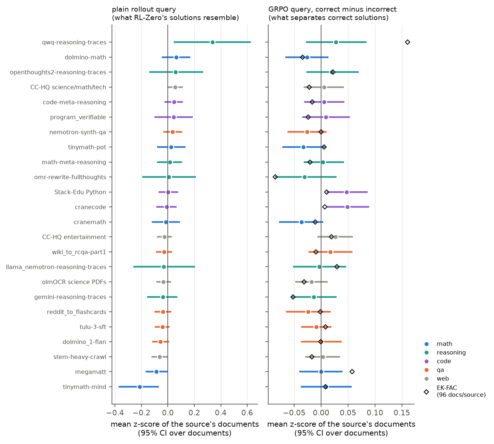

# Within-stage attribution at 7B: midtraining sources behind RL-Zero's solutions

*Run on one Lambda H100 SXM5 (80 GB) on 2026-11-01. Code: [scripts/olmo7b_midtrain.py](../../scripts/olmo7b_midtrain.py). Methods: [docs/06_attribution_methods.md](../../docs/06_attribution_methods.md). This is the first 7B run of plan v3 §5 (RQ4) for one stage. It is small (19 problems), so read it as a measurement of what the recommended pipeline can and cannot resolve at 7B, not as the study itself.*

**Question.** The pilot found that midtraining is where RL-Zero's correct solutions become likely and where the model starts to prefer correct over incorrect content. Ai2's midtraining data-mix arms make that causal at the mix level: a math-code-reasoning mix raises the correct-solution margin, a general-QA mix does not. Which sources inside the Dolmino midtraining mix do RL-Zero's solutions draw on?

## Setup

- **Queries.** `Olmo-3.1-7B-RL-Zero-Math` sampled 8 solutions (T = 1, 7,680-token cap so prompt and solution fit the 8,192-token stage-2 context; vLLM 0.11.0) for each of the 26 pilot problems where it previously succeeded only sometimes (AIME 2026, HMMT Feb 2026, Omni-MATH 4–6.5, MATH-500 level 5; Dolci near-duplicates already removed). 19 problems had mixed rewards this time (1–7 of 8 correct), giving **152 GRPO query rows** (1.08M solution tokens) with Dr. GRPO advantages. Per [queries.csv](queries.csv).
- **Documents.** 120 documents from each of 24 Dolmino sources (`allenai/dolma3_dolmino_mix-100B-1025`), drawn from 4 files per source chosen with probability proportional to size, first 1,024 tokens: 2,880 documents, 1.98M tokens. Sources are grouped as math (5), reasoning traces (6), code (4), general QA / instruction (5) and web / PDFs (4).
- **Checkpoint.** Documents and queries are scored at the end of midtraining (`Olmo-3-1025-7B@stage2-step47684`), plan v3's rule that each stage's documents are scored at that stage's own end checkpoint.
- **Methods.** TrackStar p32 (autocorrelation preconditioning, unit normalization, one column per rollout) over all 2,880 documents. Bergson normalizes each rollout's gradient after weighting it by its advantage, so each column is sign(A)·cos(q, d); the cosine is recovered exactly and any advantage vector can be applied afterwards. EK-FAC (KFAC + eigenvalue correction, last 4 of 32 layers, factors on 24 documents per source, scores on the other 96 per source), per-problem queries Σᵢ Aᵢ gᵢ built natively.
- **Two queries from the same rollouts.** The **GRPO query** weights each rollout by its advantage: the correct-minus-incorrect contrast, "what separates correct solutions". The **plain rollout query** weights all rollouts of a problem equally: "what RL-Zero's solutions resemble".
- **Controls.** Each problem's scores are z-scored over documents so that every problem counts the same. Null: advantages permuted within each problem (1,000 permutations), i.e. a contrast between random rollouts of the same problem. Reliability: Spearman correlation between source rankings from two random halves of the problems (200 splits); plan v3 §5 asks for ≥ 0.5 before analysis.

## Results

| | GRPO query, TrackStar p32 | GRPO query, EK-FAC | plain rollout query, TrackStar p32 |
|---|---:|---:|---:|
| documents per source | 120 | 96 | 120 |
| split-half reliability of the source ranking (Spearman over 19 problems) | **0.05** | **0.20** | **0.83** |
| Spearman–Brown, all 19 problems (plan v3 gate: ≥ 0.5) | 0.10 | 0.33 | 0.90 |
| largest source effect (mean z, 95% CI over documents) | 0.05 (CraneCode) | 0.16 [0.03, 0.29] (QwQ traces) | 0.34 [0.04, 0.63] (QwQ traces) |

**1. What RL-Zero's solutions resemble is measurable at 7B, and it is reasoning traces.** With the plain rollout query, the source ranking is stable across problems (split-half 0.83). QwQ reasoning traces stand out (z = +0.34, 95% CI over documents [0.04, 0.63]); TinyMATH-MIND (dialogue-style math) is least similar (−0.21 [−0.37, −0.07]). This is the gradient-space version of "RL-Zero writes like the reasoning traces it was midtrained on".

**2. What separates correct from incorrect solutions is not resolvable at the source level with this many problems.** With the GRPO query, source means are within ±0.05 standard deviations of zero, the ranking does not replicate across halves of the problems (0.05, far below the 0.5 gate), and it is unrelated to the plain query's ranking (Spearman 0.13). The two code sources with nominal permutation p ≈ 0.01–0.02 do not survive a correction for 24 sources. The math-code-reasoning minus general-QA contrast that the midtraining arms predict is +0.010 (permutation p = 0.22).

**3. The contrast moves reasoning-trace documents most, in both directions, but no more than a random contrast does.** Exploratory (added after the primary analysis failed the reliability gate): the mean |z| per source is extremely stable (split-half 0.97) and highest for reasoning traces (QwQ 1.09, `omr-rewrite-fullthoughts` 0.99) and lowest for science PDFs, Common Crawl text and Tulu 3 SFT (0.61–0.66). The same ordering appears for contrasts between randomly labelled rollouts (QwQ 1.08 under the null), so it is a property of how those documents' gradients relate to long solutions, not of correctness.

**4. EK-FAC finds more of a contrast than TrackStar, but not enough to pass the gate.** EK-FAC's source ranking for the GRPO query is more reliable than TrackStar's (split-half 0.20 against 0.05) but still below the gate (0.33 after Spearman–Brown). On a first run with 40 documents per source it was 0.38; scoring 96 per source lowered it, so part of that was noise. Its two highest sources are QwQ reasoning traces (z = +0.16 [0.03, 0.29]) and MegaMath (+0.06 [0.02, 0.09]) in both runs (the 40 documents are a subset of the 96, so this is not an independent replication), and its lowest is `omr-rewrite-fullthoughts` (−0.09 [−0.16, −0.02]). None of these survives a correction for 24 sources. QwQ is also the plain query's top source, so EK-FAC's contrast may still carry some of what correct, finished solutions look like. The two methods agree weakly: Spearman 0.30 over sources, 0.17 over documents, 18% shared top 10%.



The highest- and lowest-scored single documents for the GRPO query ([top_docs.md](top_docs.md)) are competition-math reasoning traces at both ends, consistent with point 3.

## What this means

- **Under plan v3's gate, the contrastive 7B attribution reports a limits result for this stage at this size.** The pipeline resolves *which midtraining data RL-Zero's solutions look like* (reliably, from 19 problems), but not *which data separates its correct from its incorrect solutions*. The ordering of the methods matches the synthetic gate, where TrackStar failed to recover the data the RL gain needs and EK-FAC recovered it (ρ = 0.89) ([../gate_v3/](../gate_v3/README.md)): here EK-FAC's contrast is more reliable than TrackStar's, though neither passes.
- **The likelihood ledger is consistent with a weak contrast.** In the pilot, the correct-minus-incorrect margin on the base model's own finished solutions is about 0.15 nats/token after midtraining, and RL changes the body of a solution by about 0.05 nats/token. A gradient contrast between long, similar solutions mostly cancels, and what is left varies with the problem.
- **Next steps, in order of expected value.** (1) Contrasts on matched-length pairs of *finished* solutions: here 89% of incorrect rollouts hit the 7,680-token cap against 33% of correct ones, so the contrast partly encodes "finished vs cut off". (2) The 16k-token budget RL-Zero was trained with. (3) More problems: by Spearman–Brown, TrackStar's 0.05 on halves of 9–10 problems projects only to about 0.15 on halves of 32, so more problems help EK-FAC more than TrackStar.

## Caveats

- 19 problems, 152 rollouts, one sample of 120 documents per source, one checkpoint. Exploratory; not the pre-registered study.
- The 7,680-token cap is half of RL-Zero's training budget, so incorrect rollouts are mostly truncated (see above).
- EK-FAC is restricted to the last 4 layers, with factors from 576 documents.
- Within-source variation is large (CIs over documents span ±0.1–0.3 z), so single-document claims are out of reach here, as in the gate.

## Cost

| Stage | Wall time | Notes |
|---|---:|---|
| vLLM sampling, 208 rollouts | 39 min | 603 generated tokens/s; full multi-head KV (32 KV heads) limits concurrency |
| TrackStar p32, 2,880 docs + 152 rollouts | 25 min | Hessian pass ~5,000 tokens/s at an 8,192-token batch, 77 GB peak |
| EK-FAC, last 4 layers: factors (576 docs) and 19 per-problem query builds | ~25 min (not timed separately) | factors at a 2,048-token batch; an 8,192-token batch ran out of memory |
| EK-FAC scoring, 2,304 docs × 19 problems | 32 min | four passes of 5 queries each (`score_cfg.query_batch_size`): the 19 full-gradient query rows are ~3 GB each in fp32 and do not fit on the GPU together |

## Reproduce

```bash
bash scripts/lambda/setup_remote.sh && bash scripts/lambda/setup_vllm.sh
export MID_ART=artifacts/olmo7b_midtrain
python scripts/olmo7b_midtrain.py problems && python scripts/olmo7b_midtrain.py docs
python scripts/olmo7b_midtrain.py rollouts && python scripts/olmo7b_midtrain.py queries
python scripts/olmo7b_midtrain.py attribute && python scripts/olmo7b_midtrain.py evaluate   # MID_EKFAC_SET=nofit (default)
```
