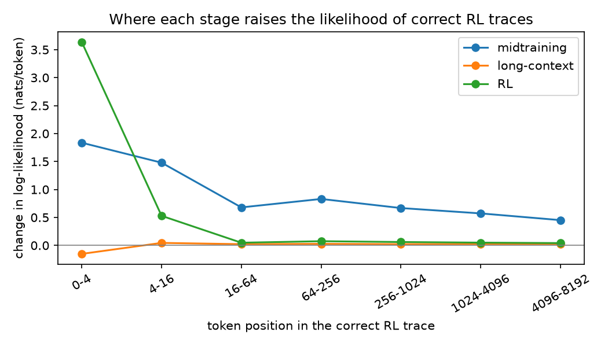
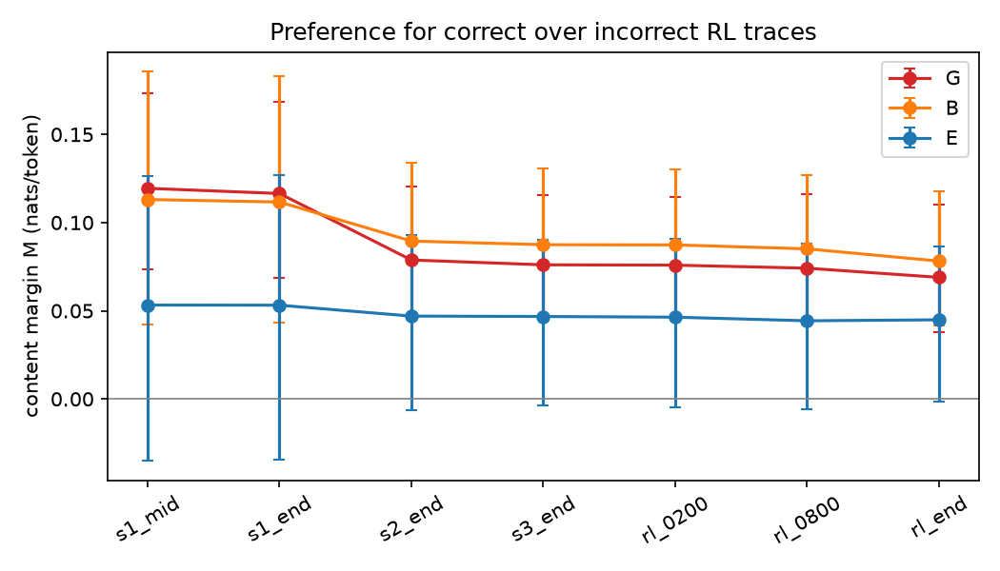
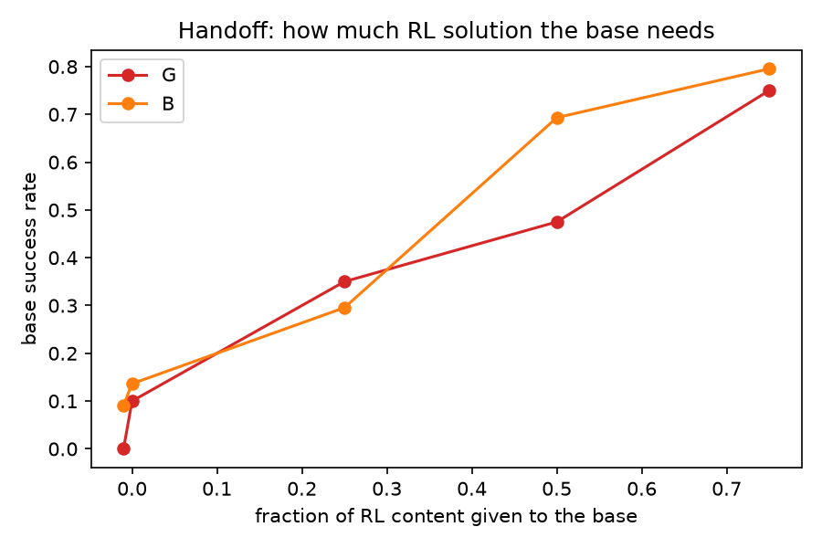

# Pilot results (exploratory)

Interpretation and caveats: [FINDINGS.md](FINDINGS.md). Generated by `scripts/pilot.py report`.

Modal spend for this pilot: **$20.62** (GPU time from job wall-clock at $3.95/H100-hour; CPU downloads included).

## 1. Accuracy, format and groups (first 16 samples per model; 7,680-token cap)

| set        |   problems |   base pass@1 |   base pass@16 |   RL pass@1 |   RL pass@16 |   base no-answer |   RL no-answer |   base lenient-strict gap |   base at cap |   RL at cap |   G |   B |   E |
|:-----------|-----------:|--------------:|---------------:|------------:|-------------:|-----------------:|---------------:|--------------------------:|--------------:|------------:|----:|----:|----:|
| aime26     |         29 |         0.043 |          0.276 |       0.192 |        0.310 |            0.489 |          0.761 |                     0.015 |         0.356 |       0.821 |   3 |   3 |   1 |
| hmmt_feb26 |         33 |         0.032 |          0.152 |       0.140 |        0.212 |            0.502 |          0.801 |                     0.009 |         0.297 |       0.860 |   2 |   1 |   1 |
| math500    |         15 |         0.217 |          0.600 |       0.658 |        0.800 |            0.342 |          0.275 |                     0.042 |         0.129 |       0.325 |   1 |   1 |   7 |
| omni_math  |         47 |         0.106 |          0.426 |       0.281 |        0.447 |            0.419 |          0.644 |                     0.032 |         0.235 |       0.725 |   1 |   6 |   7 |

## 2. Likelihood ledger and discrimination margin

35 problems, 73 matched-length (correct, incorrect) RL trace pairs. Each pair is cut to the same window (no answer line). M = mean per-token log-likelihood of correct minus incorrect traces on content tokens (the first 16 tokens excluded); L = mean per-token log-likelihood. Mean [95% bootstrap CI] over problems.

| group   | checkpoint   |   problems | M content             |   share M>0 | L correct            |
|:--------|:-------------|-----------:|:----------------------|------------:|:---------------------|
| all     | s1_mid       |         35 | 0.093 [0.054, 0.130]  |        0.83 | -1.13 [-1.16, -1.10] |
| all     | s1_end       |         35 | 0.092 [0.054, 0.128]  |        0.83 | -1.08 [-1.11, -1.05] |
| all     | s2_end       |         35 | 0.069 [0.043, 0.093]  |        0.83 | -0.52 [-0.54, -0.49] |
| all     | s3_end       |         35 | 0.066 [0.042, 0.091]  |        0.83 | -0.49 [-0.52, -0.47] |
| all     | rl_0200      |         35 | 0.066 [0.041, 0.090]  |        0.83 | -0.49 [-0.52, -0.47] |
| all     | rl_0800      |         35 | 0.065 [0.041, 0.089]  |        0.83 | -0.48 [-0.51, -0.46] |
| all     | rl_end       |         35 | 0.061 [0.038, 0.084]  |        0.8  | -0.45 [-0.47, -0.42] |
| G       | s1_mid       |          5 | 0.119 [0.073, 0.174]  |        1    | -1.07 [-1.14, -1.01] |
| G       | s1_end       |          5 | 0.116 [0.069, 0.169]  |        1    | -1.02 [-1.09, -0.97] |
| G       | s2_end       |          5 | 0.079 [0.046, 0.121]  |        1    | -0.50 [-0.56, -0.45] |
| G       | s3_end       |          5 | 0.076 [0.046, 0.116]  |        1    | -0.47 [-0.53, -0.42] |
| G       | rl_0200      |          5 | 0.076 [0.046, 0.115]  |        1    | -0.47 [-0.53, -0.42] |
| G       | rl_0800      |          5 | 0.074 [0.042, 0.116]  |        1    | -0.46 [-0.51, -0.41] |
| G       | rl_end       |          5 | 0.069 [0.038, 0.110]  |        1    | -0.43 [-0.48, -0.38] |
| B       | s1_mid       |         10 | 0.113 [0.042, 0.186]  |        0.7  | -1.09 [-1.13, -1.05] |
| B       | s1_end       |         10 | 0.112 [0.043, 0.183]  |        0.7  | -1.04 [-1.08, -1.00] |
| B       | s2_end       |         10 | 0.090 [0.047, 0.134]  |        0.8  | -0.49 [-0.53, -0.45] |
| B       | s3_end       |         10 | 0.087 [0.047, 0.131]  |        0.8  | -0.47 [-0.50, -0.43] |
| B       | rl_0200      |         10 | 0.087 [0.047, 0.130]  |        0.8  | -0.46 [-0.50, -0.43] |
| B       | rl_0800      |         10 | 0.085 [0.046, 0.127]  |        0.8  | -0.45 [-0.49, -0.42] |
| B       | rl_end       |         10 | 0.078 [0.041, 0.118]  |        0.8  | -0.42 [-0.45, -0.39] |
| E       | s1_mid       |          9 | 0.053 [-0.035, 0.126] |        0.89 | -1.15 [-1.21, -1.10] |
| E       | s1_end       |          9 | 0.053 [-0.034, 0.127] |        0.89 | -1.10 [-1.16, -1.05] |
| E       | s2_end       |          9 | 0.047 [-0.006, 0.093] |        0.89 | -0.51 [-0.55, -0.47] |
| E       | s3_end       |          9 | 0.047 [-0.004, 0.090] |        0.89 | -0.49 [-0.52, -0.45] |
| E       | rl_0200      |          9 | 0.046 [-0.005, 0.091] |        0.89 | -0.49 [-0.52, -0.45] |
| E       | rl_0800      |          9 | 0.044 [-0.006, 0.088] |        0.89 | -0.47 [-0.51, -0.44] |
| E       | rl_end       |          9 | 0.045 [-0.001, 0.086] |        0.78 | -0.44 [-0.47, -0.41] |

Robustness, pairs whose incorrect trace finished (10 problems): M content by checkpoint

| checkpoint   | M                      |
|:-------------|:-----------------------|
| s1_mid       | -0.004 [-0.093, 0.078] |
| s1_end       | -0.005 [-0.092, 0.076] |
| s2_end       | 0.003 [-0.054, 0.056]  |
| s3_end       | 0.005 [-0.050, 0.057]  |
| rl_0200      | 0.004 [-0.051, 0.057]  |
| rl_0800      | 0.004 [-0.050, 0.056]  |
| rl_end       | 0.004 [-0.047, 0.054]  |

Stage increments of M (exact telescoping; they sum to `total`, the change from mid-pretraining to the final RL model):

|       |   pretrain_late |   midtrain |   longctx |   rl_early |   rl_mid |   rl_late |   total |
|:------|----------------:|-----------:|----------:|-----------:|---------:|----------:|--------:|
| all   |          -0.001 |     -0.024 |    -0.002 |     -0.000 |   -0.001 |    -0.004 |  -0.031 |
| B     |          -0.001 |     -0.022 |    -0.002 |     -0.000 |   -0.002 |    -0.007 |  -0.035 |
| E     |          -0.000 |     -0.006 |    -0.000 |     -0.000 |   -0.002 |     0.001 |  -0.008 |
| G     |          -0.003 |     -0.038 |    -0.003 |     -0.000 |   -0.002 |    -0.005 |  -0.050 |
| other |           0.001 |     -0.032 |    -0.004 |      0.000 |    0.000 |    -0.004 |  -0.039 |

Opening (first 16 tokens) vs content log-likelihood of correct traces, and the opening margin:

| checkpoint                  |   opening |   content |   opening_margin |
|:----------------------------|----------:|----------:|-----------------:|
| s1_mid                      |    -2.912 |    -1.130 |           -0.204 |
| s1_end                      |    -3.043 |    -1.080 |           -0.199 |
| s2_end                      |    -1.474 |    -0.520 |           -0.226 |
| s3_end                      |    -1.479 |    -0.496 |           -0.222 |
| rl_0200                     |    -0.713 |    -0.493 |           -0.055 |
| rl_0800                     |    -0.436 |    -0.482 |           -0.019 |
| rl_end                      |    -0.173 |    -0.447 |           -0.014 |
| s1_2T                       |    -2.921 |    -1.141 |           -0.244 |
| arm_round5                  |    -1.578 |    -0.546 |           -0.261 |
| arm_gen_mc_only             |    -2.959 |    -1.037 |           -0.235 |
| arm_math_code_reasoning_web |    -1.619 |    -0.550 |           -0.239 |

Midtraining data-mix arms (100B tokens from the ~2T stage-1 checkpoint), change relative to that checkpoint:

| arm                                   | dM vs 2T                | dL correct vs 2T   |
|:--------------------------------------|:------------------------|:-------------------|
| arm_round5                            | -0.022 [-0.036, -0.007] | 0.60 [0.58, 0.62]  |
| arm_gen_mc_only                       | 0.005 [0.002, 0.008]    | 0.10 [0.10, 0.11]  |
| arm_math_code_reasoning_web           | -0.022 [-0.035, -0.007] | 0.59 [0.58, 0.61]  |
| math_code_reasoning_web - gen_mc_only | -0.027 [-0.040, -0.011] | 0.49 [0.47, 0.51]  |

Change in per-token log-likelihood of correct traces by token position:

|           |   midtraining |   long-context |    RL |
|:----------|--------------:|---------------:|------:|
| 0-4       |         1.836 |         -0.152 | 3.635 |
| 4-16      |         1.479 |          0.045 | 0.529 |
| 16-64     |         0.679 |          0.022 | 0.048 |
| 64-256    |         0.831 |          0.028 | 0.075 |
| 256-1024  |         0.668 |          0.022 | 0.060 |
| 1024-4096 |         0.572 |          0.025 | 0.049 |
| 4096-8192 |         0.452 |          0.023 | 0.041 |

## 2b. Margin on the base model's own finished solutions

32 problems, 39 pairs of *finished* base solutions (one correct, one incorrect), answer regions within 2x in length, both cut to the same window before the answer line. This avoids the truncation confound of section 2.

| checkpoint                  |   problems | M content              |   share M>0 | L correct            | L incorrect          |
|:----------------------------|-----------:|:-----------------------|------------:|:---------------------|:---------------------|
| s1_mid                      |         32 | -0.029 [-0.135, 0.082] |        0.41 | -1.03 [-1.11, -0.94] | -1.00 [-1.10, -0.90] |
| s1_end                      |         32 | -0.026 [-0.131, 0.084] |        0.41 | -0.99 [-1.07, -0.90] | -0.96 [-1.07, -0.86] |
| s2_end                      |         32 | 0.120 [0.014, 0.233]   |        0.59 | -0.51 [-0.59, -0.44] | -0.63 [-0.76, -0.52] |
| s3_end                      |         32 | 0.114 [0.012, 0.223]   |        0.56 | -0.48 [-0.56, -0.41] | -0.59 [-0.72, -0.49] |
| rl_0200                     |         32 | 0.117 [0.014, 0.228]   |        0.59 | -0.48 [-0.56, -0.41] | -0.60 [-0.72, -0.49] |
| rl_0800                     |         32 | 0.115 [0.010, 0.228]   |        0.56 | -0.49 [-0.57, -0.42] | -0.61 [-0.73, -0.50] |
| rl_end                      |         32 | 0.096 [-0.011, 0.214]  |        0.5  | -0.54 [-0.62, -0.47] | -0.63 [-0.76, -0.53] |
| s1_2T                       |         32 | -0.034 [-0.140, 0.074] |        0.41 | -1.04 [-1.13, -0.96] | -1.01 [-1.12, -0.91] |
| arm_round5                  |         32 | 0.125 [0.018, 0.239]   |        0.56 | -0.53 [-0.62, -0.46] | -0.66 [-0.79, -0.54] |
| arm_gen_mc_only             |         32 | -0.009 [-0.113, 0.103] |        0.41 | -0.93 [-1.02, -0.85] | -0.92 [-1.03, -0.82] |
| arm_math_code_reasoning_web |         32 | 0.129 [0.021, 0.244]   |        0.59 | -0.54 [-0.62, -0.46] | -0.67 [-0.80, -0.55] |

Stage increments of M (mean [95% CI]):

|               | increment               |
|:--------------|:------------------------|
| pretrain_late | 0.003 [-0.003, 0.008]   |
| midtrain      | 0.146 [0.094, 0.198]    |
| longctx       | -0.006 [-0.011, -0.001] |
| rl_early      | 0.003 [0.001, 0.005]    |
| rl_mid        | -0.002 [-0.006, 0.002]  |
| rl_late       | -0.019 [-0.027, -0.010] |
| total         | 0.125 [0.075, 0.175]    |

## 3. Handoff map

Base success rate when given the first fraction of a correct RL trace's content region (s@-0.01 = no prefix; s@0 = the RL trace's first 16 tokens only).

| group   |   s@-0.01 |   s@0 |   s@0.25 |   s@0.5 |   s@0.75 |      n |   share h<=0.1 |   share composition |
|:--------|----------:|------:|---------:|--------:|---------:|-------:|---------------:|--------------------:|
| B       |     0.091 | 0.136 |    0.295 |   0.693 |    0.795 | 11.000 |          0.182 |               0.000 |
| G       |     0.000 | 0.100 |    0.350 |   0.475 |    0.750 |  5.000 |          0.200 |               0.400 |

